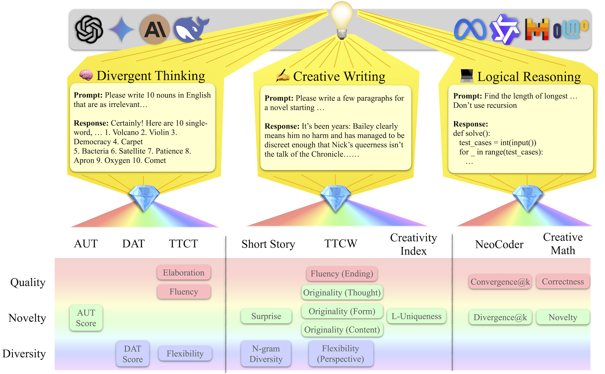

<!-- Hero -->

    <h1>CreativityPrism</h1>
    
A benchmark for creative reasoning in LLMs — Quality · Novelty · Diversity

    

        <a href="https://arxiv.org/abs/2510.20091" target="_blank" rel="noopener">📄 arXiv</a>
        <a href="https://huggingface.co/datasets/joeyhou/creativityprism_v1/settings" target="_blank" rel="noopener">🗂 data</a>
        <a href="https://github.com/joeyhou/creativityprism" target="_blank" rel="noopener">💻 code</a>
    

<!-- KPIs (edit the numbers or compute them later) -->

    

17

LLMs

    

8

Tasks

    

3

Dimensions

    

17

Metrics

## What is CreativityPrism?
Creativity is often seen as a hallmark of human intelligence. While large language models (LLMs) are increasingly perceived as generating creative text, there is still no cross-domain and scalable framework to evaluate their creativity across diverse scenarios. Existing methods of LLM creativity evaluation either heavily rely on humans, limiting speed and scalability, or are fragmented across different domains and different definitions of creativity. To address this gap, we propose CREATIVITYPRISM, an evaluation and analysis framework that consolidates eight tasks from three domains: divergent thinking, creative writing, and logical reasoning, into a taxonomy of creativity that emphasizes three dimensions: quality, novelty, and diversity of LLM generations. The framework is designed to be scalable with reliable automatic evaluation judges that have been validated against human annotations. We evaluate 17 state-of-the-art (SoTA) LLMs on CREATIVITYPRISM and find that while frontier-scale LLMs dominate creative writing and logical reasoning tasks by a .10 (or 15%) lead over locally-deployable open models, they offer no significant advantage in divergent thinking, a domain much less explored in existing post-training regimes. Our analysis also shows that high performance in one creative dimension or domain rarely generalizes to others; specifically, novelty metrics often show weak or negative correlations with other metrics. This fragmentation confirms that a cross-domain, multi-dimensional framework like CREATIVITYPRISM is essential for any meaningful assessment of LLM creativity.

---

    <h2 id="overview">Overview</h2>
    <figure>
        
        <figcaption>Domains, tasks, and metric dimensions.</figcaption>
    </figure>

