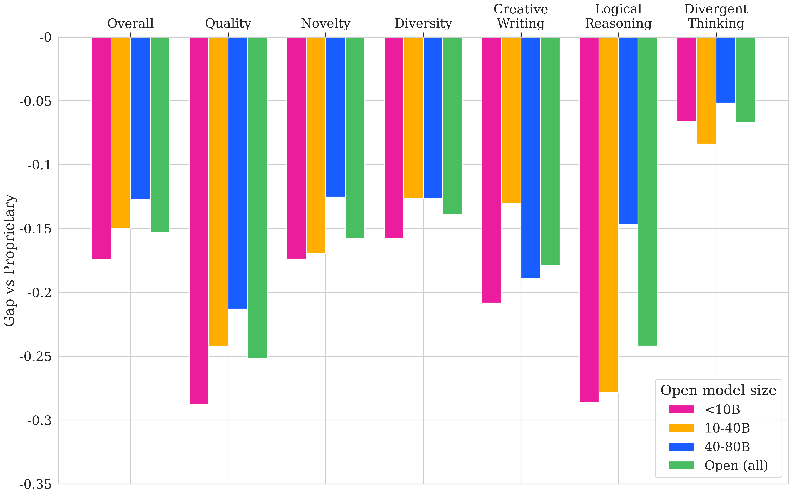
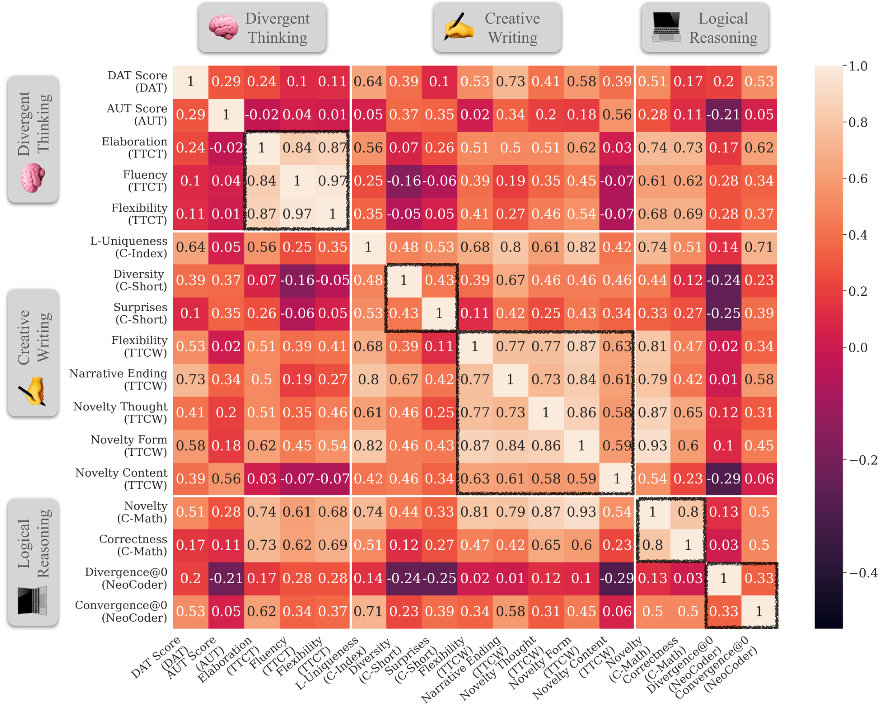
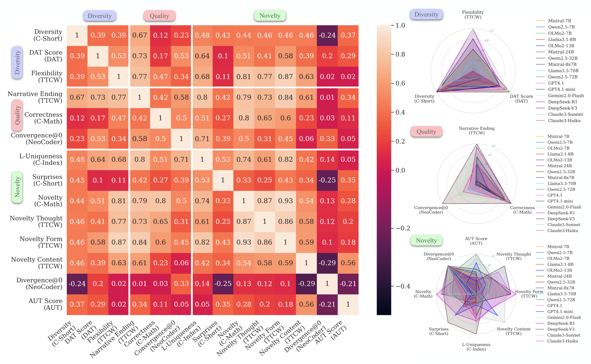

# Key findings

## Frontier-scale vs. open models

The best frontier-scale models beat the best open models **by more than .10 (15%)** in every dimension, as most people would expect; but where that gap comes from is the more interesting part:

- **By domain.** The gap is widest in logical reasoning and creative writing, and much narrower in divergent thinking. Coding and mathematical reasoning are in every frontier model's technical report; writing data shows up in most post-training mixes, while divergent thinking is in none of them.
- **By dimension.** Quality separates the two groups more than novelty or diversity do, consistent with the same explanation above, since quality carries the reasoning-heavy metrics (NeoCoder Convergence@0, Creative Math Correctness).

<figure>
  
  <figcaption>Figure 3(b): Performance gap between frontier-scale and open models.</figcaption>
</figure>

## Time of Knowledge Cutoff

We have also found a performance improvement along the time axis: several of our
metrics reward content that differs from what came before (L-Uniqueness in
Creativity Index, Divergence@0 in NeoCoder), so a later training cutoff is itself
an advantage.

<figure>
  
  <figcaption>Figure 3(a): Creativity scores increase with more recent model release dates.</figcaption>
</figure>

## Correlation across metrics

We correlated every model's performance across every pair of metrics
(Pearson's r). The structure that comes out:

- **Within a task, metrics agree.** TTCT's internal metrics correlate at ≥0.84.
  Creative writing tasks also agree with each other, more than tasks in the other
  domains do.
- **Within a dimension, it depends which dimension.** Quality metrics highly correlate with each
  other, and so do diversity metrics, even across unrelated tasks. On the other hand, **Novelty** metrics do not correlate well with each other. They correlate weakly with each other, and sometimes negatively, e.g., Creative Short Story's Surprises and NeoCoder's Divergence@0 sit at **-0.25**.
- **Across domains, little agreement.** A model strong in one domain or dimension
  is not reliably strong in another.

<figure>
  
  <figcaption>Figure 4: Correlations across all metrics.</figcaption>
</figure>

<figure>
  
  <figcaption>Figure 5: Correlations and model performance profiles by creativity dimension.</figcaption>
</figure>

## Why novelty behaves differently

Novelty is the only dimension that has to
ask *novel compared to what?*, and each task answers differently: against a
human-written corpus, against known human solutions, or against common
conceptual associations. Quality asks whether an output is well-formed, which is
intrinsic to it; diversity asks how much outputs differ from each other, which is
measurable inside one model's own generations. Novelty always needs an outside
reference, and those references are not the same thing.

This echoes our motivation: **no single creativity metric stands in for the rest and performing well in one metric or one dimension does not guarantee good performance in another.**